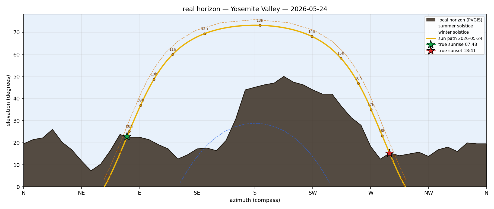

# Real Horizon

[](https://github.com/hacs/integration)
[](LICENSE)

A Home Assistant integration that knows your **actual** sunrise and sunset — the
time the sun *really* clears the hills, trees, or buildings around you, not the
theoretical time it would rise over a flat ocean horizon.

It also ships a Lovelace card that draws today's sun and moon arcs over a
silhouette of your local terrain.



*Yosemite Valley, today. Granite walls climb to 50° on the southern side —
the winter-solstice sun (blue dashed line) never clears the valley walls at all.*

## What it does

- Fetches the 360° horizon profile for your Home Assistant `latitude` /
  `longitude` from [PVGIS](https://re.jrc.ec.europa.eu/) (free, no key, global,
  built on SRTM elevation data).
- Computes the sun's path and intersects it with the local horizon, so
  *true sunrise* and *true sunset* reflect when the sun actually appears
  and disappears for **you**.
- Computes the moon's position and phase, with the same horizon-aware
  rise/set times.
- Registers a Lovelace card automatically — no manual resource setup.

## Entities

Once configured, the integration creates one device with these entities:

| Entity | Type | What it tells you |
| --- | --- | --- |
| `sensor.real_horizon_true_sunrise` | timestamp | The next time the sun rises above your local horizon |
| `sensor.real_horizon_true_sunset` | timestamp | The next time the sun drops below your local horizon |
| `sensor.real_horizon_sun_clearance` | ° | `sun_altitude − horizon(sun_azimuth)` — positive when the sun is visible |
| `sensor.real_horizon_horizon_at_sun_azimuth` | ° | The horizon height directly under the sun |
| `sensor.real_horizon_local_horizon_profile` | string + attrs | The full 360° profile, sun and moon paths, and crossings (used by the card) |
| `binary_sensor.real_horizon_sun_above_local_horizon` | bool | Whether the sun is currently visible to you |

The moon attributes — current azimuth/elevation/phase, current arc, and
horizon-aware moonrise/moonset times — live on
`sensor.real_horizon_local_horizon_profile`.

## Install

### HACS (recommended)

1. In HACS → **Integrations** → ⋮ → **Custom repositories**, add
   `https://github.com/kali/real-horizon` (category: *Integration*).
2. Install **Real Horizon**, then restart Home Assistant.
3. **Settings → Devices & services → Add integration → Real Horizon.**

The card loads itself. Just add it to any dashboard:

```yaml
type: custom:real-horizon-card
entity: sensor.real_horizon_local_horizon_profile
```

### Manual

1. Copy `custom_components/real_horizon/` into your HA `config/custom_components/`.
2. Restart Home Assistant.
3. Add the integration as above.

## How accurate are the rise/set times?

The horizon comes from PVGIS, which samples SRTM at roughly 90 m resolution.
That captures ridges, hills, and cliffs reliably, but misses close-range
obstructions (trees, neighbouring buildings). Expect agreement with reality
to within a few minutes in open terrain, ~10 min in dense local cover.
In a narrow valley the 90 m grid can also invent or flatten ridges by
several degrees. If that happens where you live, measure the horizon yourself
and add [horizon overrides](#horizon-overrides).

The sun position itself is computed with `astral` and is sub-second accurate.
The moon position uses a low-precision Meeus algorithm (main periodic terms)
accurate to a few arcminutes — plenty for moonrise/moonset on land.

Atmospheric refraction (~0.57° lift at the horizon) is **not** applied; this
makes true sunrise ~1–2 min later than reality and true sunset ~1–2 min
earlier on a level horizon. On a 20° terrain horizon the effect is negligible.

## Config

There's nothing to configure beyond clicking *Submit* on the config-flow page:
the integration uses the latitude/longitude already set in your Home Assistant
configuration.

If you change those values later, remove the integration and add it back so
the cached horizon profile is refetched. (A `lat`/`lon`-change reload is on
the todo list.)

### Horizon overrides

Where PVGIS is wrong for your spot, you can correct it with your own
measurements. Go to **Settings → Devices & services → Real Horizon →
Configure** and paste either:

- an export from the iOS [Theodolite](https://hrtapps.com/theodolite/) app.
  Aim at the skyline, take a reading, repeat, then share the log as text.
  The app has to be set to **True North**. The review step tells you if any
  readings were taken against magnetic north. Or:
- a plain list, one `azimuth, elevation` pair per line in degrees, with
  azimuth measured from true north. Lines starting with `#` are ignored.

  ```
  # azimuth, elevation
  82, 9.0
  90, 12.3
  105, 13.7
  ```

Your measurements are joined by straight lines. Between two neighbouring
readings that are at most *max gap* apart (default 30°), that line
**replaces** PVGIS. Everywhere else PVGIS stays as it is. So you only have to
measure the part of the skyline that's wrong. Repeated readings at the same
azimuth are averaged. A reading with no neighbour within the max gap is
ignored. Before saving, a review step lists the arcs that will be replaced
and any readings that will be ignored.

The card draws your measurements as small hollow dots over the silhouette.
To remove the overrides, clear the text field and submit.

## License

MIT. See [LICENSE](LICENSE).
